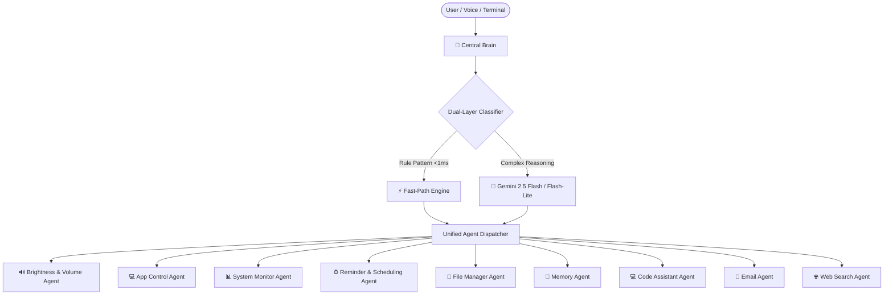

# Orion Central Brain (Unified Command Dispatcher)

The **Central Brain** is the master router and orchestrator for the Orion multi-agent system. Instead of talking to 9 individual agents separately, you can provide any natural language or direct command to the Central Brain, and it automatically classifies, transfers, and executes the request with the appropriate specialized agent.

---

## Architecture & How It Works



---

## 9 Connected Agents

| # | Agent Name | Agent ID | Example Commands |
|---|---|---|---|
| 1 | **Brightness & Volume** | `volume_brightness_agent` | `"set volume to 70"`, `"mute"`, `"dim screen"`, `"movie mode"`, `"pause music"` |
| 2 | **App Control** | `app_control_agent` | `"open chrome"`, `"close notepad"`, `"minimize all"`, `"list running apps"` |
| 3 | **System Monitor** | `system_monitor_agent` | `"cpu usage"`, `"how much ram is free"`, `"check battery"`, `"system stats"` |
| 4 | **Reminder & Scheduling** | `reminder_agent` | `"remind me to call John at 5pm"`, `"morning briefing"`, `"list reminders"` |
| 5 | **File Manager** | `file_manager_agent` | `"clean desktop"`, `"find duplicate files"`, `"storage hogs"`, `"find file *.py"` |
| 6 | **Memory** | `memory_agent` | `"remember that I prefer Python & dark mode"`, `"list memories"`, `"search memory"` |
| 7 | **Code Assistant** | `code_assistant_agent` | `"write python script to fetch REST API"`, `"explain this function"`, `"fix bug"` |
| 8 | **Email** | `email_agent` | `"read emails"`, `"find unread emails"`, `"daily email briefing"` |
| 9 | **Web Search** | `web_search_agent` | `"search latest news on AI"`, `"weather in Tokyo"`, `"stock price of AAPL"` |

---

## How to Run

### 1. Interactive Command Line Interface (CLI)
Double-click `run_brain.bat` in the root folder, or run:
```bash
python -m central_brain.brain
```

### 2. Multi-Agent Menu Launcher
Double-click `run_menu.bat` and press `[B]` to launch the Central Brain.

### 3. Python API Integration
```python
from central_brain import CentralBrain

brain = CentralBrain()

# Give ANY command - Brain figures out the agent and executes it
result = brain.process_command("what is my current cpu usage?")
print(f"Agent: {result.agent_name}")
print(f"Time: {result.execution_time_ms}ms")
print(f"Output: {result.output}")

# Inspect routing decision without executing
decision = brain.route_only("dim display brightness to 30%")
print(f"Target Agent: {decision.agent_id} (Confidence: {decision.confidence})")
```

---

## CLI Special Commands

Inside the Central Brain interactive console:
- `/status` - Live health check matrix of all 9 connected agents
- `/agents` - Detailed list of agent capabilities and registered keywords
- `/history` - View recent routing and dispatch history with execution latencies
- `/clear` - Clear console and re-render Central Brain dashboard
- `/help` - Show example commands
- `exit` or `quit` - Shutdown Central Brain
